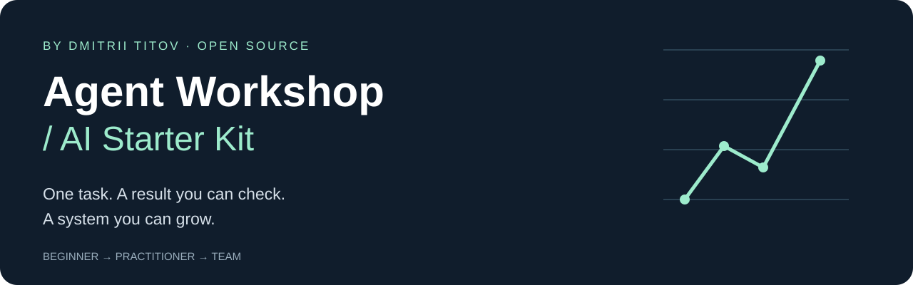
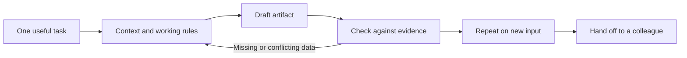

<p align="center"></p>

# Agent Workshop / AI Starter Kit

**Turn one everyday task into a repeatable AI workflow. Then build a workspace your team can use.**

An English-language, open-source starter kit by **Dmitrii Titov**, AI practitioner, product builder, and corporate AI educator. Built for people starting from zero: no coding, terminal, GitHub account, or API key required for the learning path.

[Download the starter kit](https://github.com/Dima8894/agent-workshop-starter-kit/releases/latest/download/agent-workshop-starter-kit.zip) · [Start here](docs/START-HERE.md) · [Try a worked example](examples/supply-check/README.md) · [For teams](docs/TEAM-PLAYBOOK.md)

## Your first session

1. **Download and unzip** the kit into a folder called `My AI Workshop`.
2. **Open that folder in Codex** or another assistant with local file access. Prefer a chat? Use [CHATGPT-START.txt](CHATGPT-START.txt).
3. **Send the prompt below.** Bring a workshop worksheet, a description of a task, or choose the fictional example.

```text
Read AGENTS.md and start my onboarding. I am new to this.
Ask one question at a time, help me choose one useful task,
and guide me toward a small result I can check.
Use fictional data until we agree which real data is appropriate.
```

The kit is free. Your chosen AI service has its own access requirements and charges. You only need one assistant. See [setup and troubleshooting](docs/START-HERE.md).

## What you will build

Start with three short documents: **the task**, **the workflow**, and **the checks**. Your assistant helps fill them in through a follow-up interview, makes one useful artifact, and records how to repeat it. Your own work stays in `workspace/`, excluded from normal Git tracking and release archives.

| Starting point | First useful outcome | Where to go |
| --- | --- | --- |
| “I have never used an agent.” | A checked report using fictional data | [Guided start](docs/START-HERE.md) |
| “I have a workshop worksheet.” | One part of your paper workflow running | [Workshop bridge](docs/WORKSHOP-BRIDGE.md) |
| “I want this to work every week.” | A repeatable procedure and exception checks | [Learning path](docs/LEARNING-PATH.md) |
| “My team needs a common way of working.” | Project owners, handoffs, and review criteria | [Team playbook](docs/TEAM-PLAYBOOK.md) |

## Learn by earning evidence

**Explorer → Maker → Checker → Repeater → Teammate**

Each milestone needs an artifact or a demonstrated action. Catching a wrong answer counts as progress. There are no streaks, leaderboards, or points for sharing private data. Turn milestones off whenever you like. [See the learning passport](templates/progress.md).

## Small start. Room to grow.



The architecture adapts a real orchestration pattern used at Alpes: a shared navigation layer, independent projects, explicit sources, local instructions, and reviewable decisions. The public kit contains generic templates and fictional examples, not internal company files. [Architecture](docs/ARCHITECTURE.md) · [Context design](docs/CONTEXT-ENGINEERING.md) · [Privacy](docs/PRIVACY.md)

## Inside the kit

- `AGENTS.md`: the assistant's entry point and working boundaries.
- `onboarding/`: adaptive interview, resume rules, and an example conversation.
- `templates/`: blank task, workflow, verification, project, and handoff documents.
- `examples/`: fictional practice cases with expected outputs.
- `docs/`: beginner guidance, team adoption, architecture, and evaluation.
- `tools/`: optional maintainer tools; learners do not need to run them.

This is a guided workspace and learning system. It does not install a background agent, connect a CRM, or run scheduled jobs. Those are optional later steps with their own access and testing requirements.

## About the creator

I am Dmitrii Titov. I run practical AI workshops for company teams and build MCP connectors and frontend tools. My work includes Slota, a project that gives Codex structured context and methods to work with. I want more people to understand how to apply AI to their own work: choose a useful task, give it the right context, and check what comes back.

This kit brings that approach into an English-language resource anyone can use, adapt, or teach. It stands on its own; a workshop, a paid program, and a Slota account are not prerequisites.

[About Dmitrii](docs/ABOUT.md) · [Alpes workshop](https://alpes-it.ru/workshop) · [Team learning](https://alpes-it.ru/team-ai) · [Contact Dmitrii](https://t.me/Dmitrii_Alpes)

The Alpes pages are external resources and may be in Russian. All learning materials in this repository are in English.

## Open source, with clear boundaries

[MIT licensed](LICENSE). Adapt it for your own practice, internal training, or commercial delivery with the license notice retained. [Contribute](CONTRIBUTING.md) · [Evaluation and limitations](docs/EVALUATION.md) · [Roadmap](docs/ROADMAP.md) · [Attribution](ATTRIBUTION.md)

Independent educational project. Not an official OpenAI, Anthropic, or NVIDIA product, certification, or endorsement.
